# Search and Track

**A Cold War air-defense command simulator.** Sit a watch at a SAGE direction center in Maine or at a PVO command post in the Urals, 1956–1987. Radars report what physics lets them see. Telephone lines fail. Higher headquarters wants evidence. Every return could be the start of the war, or a lost Cessna.

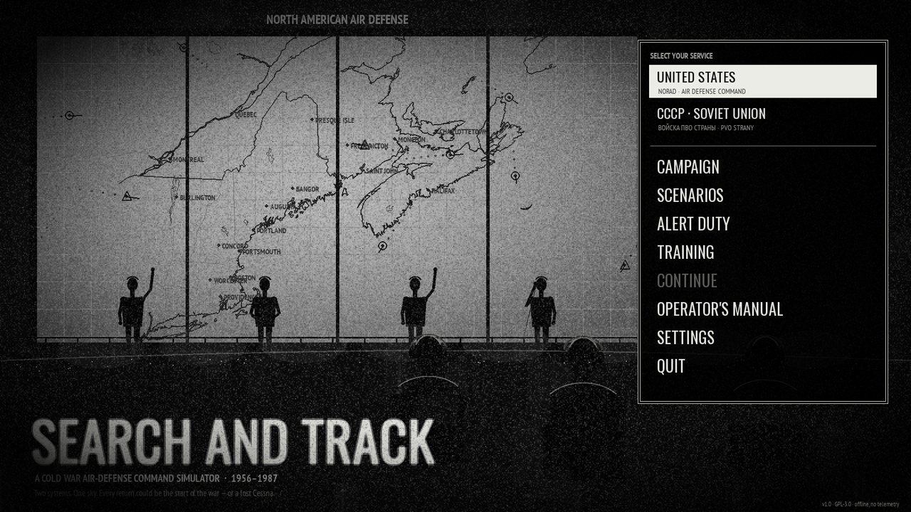

Two services share one simulation and play nothing alike:

| | NORAD / Air Defense Command | PVO Strany |
|---|---|---|
| Picture | SAGE situation display, computer-generated symbols on a cyan tube; light gun; plots every scan | Glass plotting board lettered by hand; telephoned reports 2½–4½ minutes old |
| Control | Direction center vectors by voice, then by data link | Guidance points, each with its own radar, in real time |
| Height | Nodding height finders, one track at a time | V-beam radars, every target, coarsely |
| Identity | IFF/SIF and flight plans (±5 min, 10/20 nm) | Monthly IFF codes, Aeroflot schedules, eyes |
| Consoles | Putty and olive, lens keys, cyan phosphor | Slate enamel, keycaps, amber phosphor; a plotting board lettered in Russian (everything else in English) |

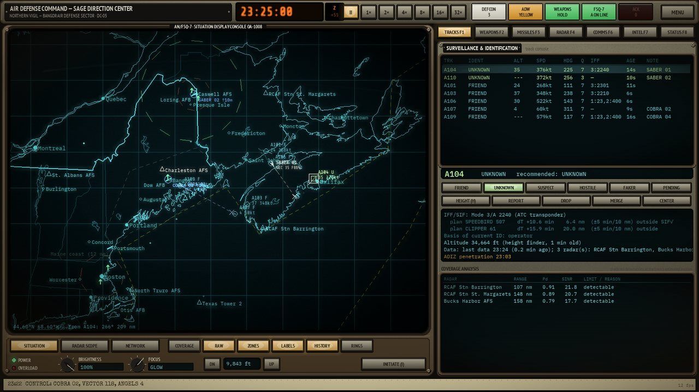
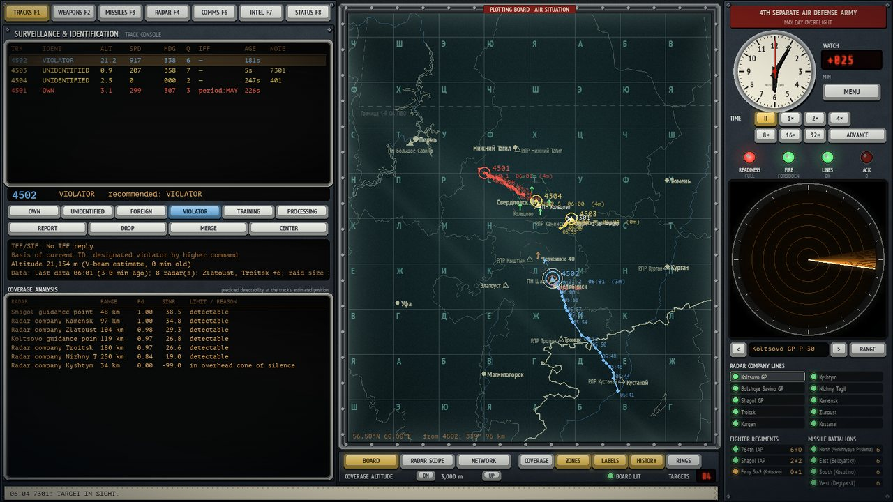

## Battles and the war

Then the Cold War turns hot. In a **battle** both sides fight on their own — bombers, jammers, shadowers, escorts, cruise missiles, ships that steam, turn and fire — and you command the air defense from the radar picture: standing orders, priority targets, decisions with a deadline, reinforcements, and any order you like by hand. Your staff runs the routine. Or **spectate** and watch it unfold; take command whenever you like. **The war** strings five battles together, from the last hours of peace to the ceasefire: what you lose stays lost, what you destroy does not come back the next night, your pilots have names, and the story between the battles is written by what you did.

| Battle | Side | |
|---|---|---|
| The Bear Watch | US | Escort the BEARs weapons tight — then the FLASH, and the first raid of the war |
| The Outer Air Battle | US | BACKFIRE regiment against the Carl Vinson group in the Bering Sea |
| The Second Raid | US | The regiment's survivors, a fresh squadron down the Strait, the FRUNZE closing with Granits |
| Bears over the Pole | US | BEAR H carriers with cruise missiles against Alaska's bases; FOXHOUNDs hunting the Sentries |
| The Last Night | US | One hour to the ceasefire; then a straggler after the guns have stopped |
| Shadows on the Border | PVO | Escort the RC-135, the Orion and the Blackbird — then the war, and the first Tomahawks |
| The Northern Bastion | PVO | Tomahawks low over Finnmark, a carrier strike with HARM shooters, B-52s with Harpoons for the KIROV |
| The Second Strike | PVO | ALCMs from the north, Tomcats sent deep for the A-50, the second carrier strike |
| The Baltic Front | PVO | F-111s at 60 metres, Wild Weasels, EF-111 jammers and F-15Cs against Leningrad's shield |
| The Capital | PVO | B-52 cruise missiles for Moscow's air defence in the last hour; then a crippled bomber after seven |

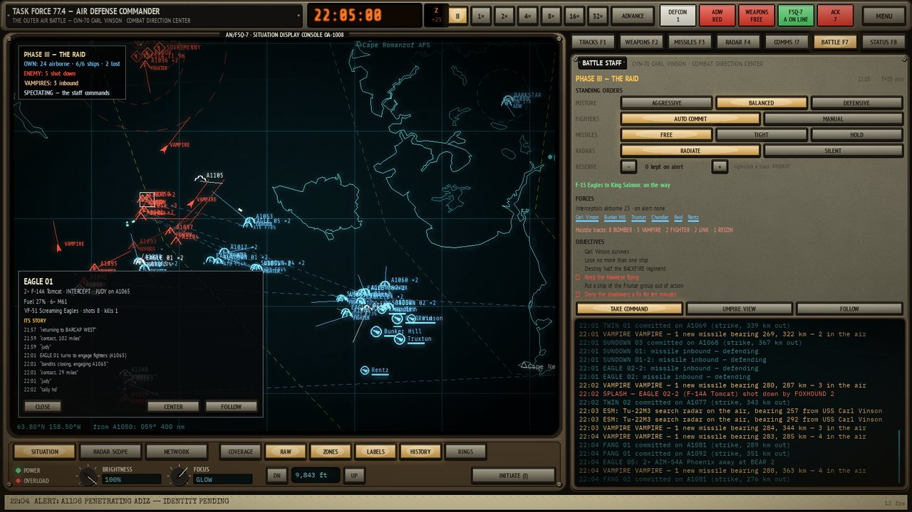
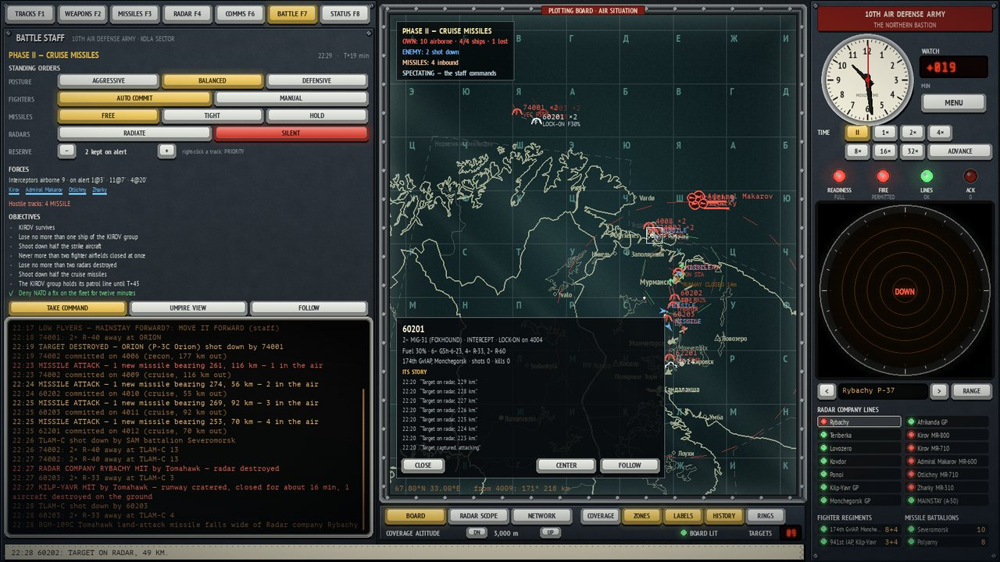
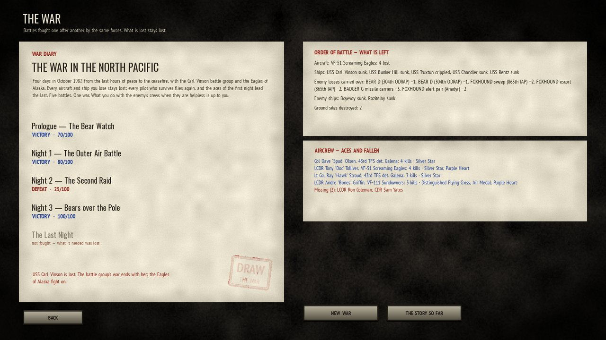
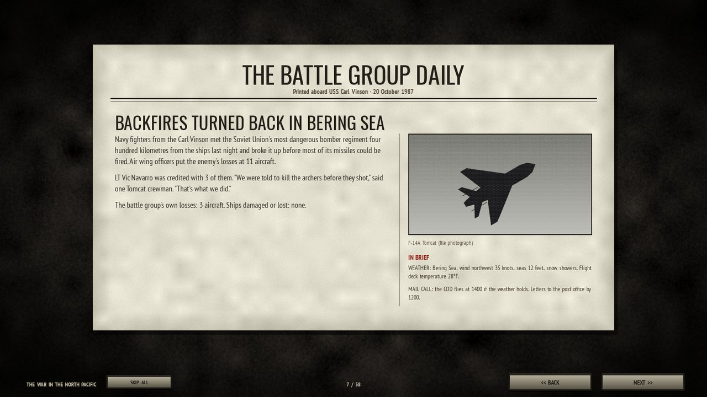

## What is in it

- **Radar physics, not scripts.** Radar equation with aspect-dependent cross-section and pulse integration, Swerling fluctuation, operator-set false-alarm threshold, 4/3-Earth horizon and ducting, terrain masking from real elevation data, lobing, clutter, MTI blind speeds, pulse-Doppler look-down and its notch, height finders, V-beam and 3D radars, IFF/SIF.
- **Electronic countermeasures.** Barrage and spot noise jammers, strobes on the scope, strobe triangulation into jammer tracks, frequency channels, frequency agility, burn-through.
- **Interception.** Alert states, scramble delays over real lines, lead-collision, stern-conversion and pursuit geometry, predicted intercept points, fuel and bingo, airborne radar contact, tally, visual identification, forced-landing signals, warning shots, ramming.
- **Missiles.** Nike, BOMARC (Senior Director's key), Hawk; S-25, S-75, S-125, S-200, S-300PT: designation, acquisition of whatever is strongest in the gate, salvos, debris, reloads, friendly-fighter holds.
- **Authority.** Weapons HOLD/TIGHT/FREE, requests to higher headquarters answered on evidence and after a delay, exercise rules with simulated kills, special-weapons release, consequences.
- **A network that fails.** Data lines and telephone lines, the AN/FSQ-7 duplex and its switchover, radar faults and maintenance, alerts awaiting acknowledgement.
- **Eras and content.** Ten historically inspired watches from Genetrix (1956) to Rust's flight to Red Square (1987); six instructor-led training lessons; procedurally generated Alert Duty on real orders of battle; a career campaign with a service record; a full operator's manual.
- **Battles.** Autonomous air groups with missions, fuel, weapons and nerve; ships in formation with missile channels, close-in guns and chaff; anti-ship, land-attack and anti-radiation missiles; cratered runways and wrecked radars; a battle staff that identifies, commits and keeps the patrols manned; a director that paces each battle through its phases; spectator mode, an umpire's view, unit stories and a tactical replay.
- **The war.** Five battles a side, from the last hours of peace to the ceasefire, fought by the same forces — losses, repairs and replacements carried over on both sides — and told between the battles in teletypes, letters home and newspapers that name your aces and your dead. Named aircrews with kills, decorations and promotions; mercy that the war remembers.
- **Debrief.** A truth replay of the whole shift, detection and identification timings, why each miss was missed, grades, and the next morning's newspaper.
- **Music** synthesized as you play, following the situation from a quiet watch to a raid; three difficulty levels.

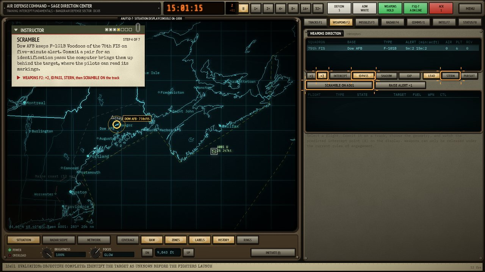
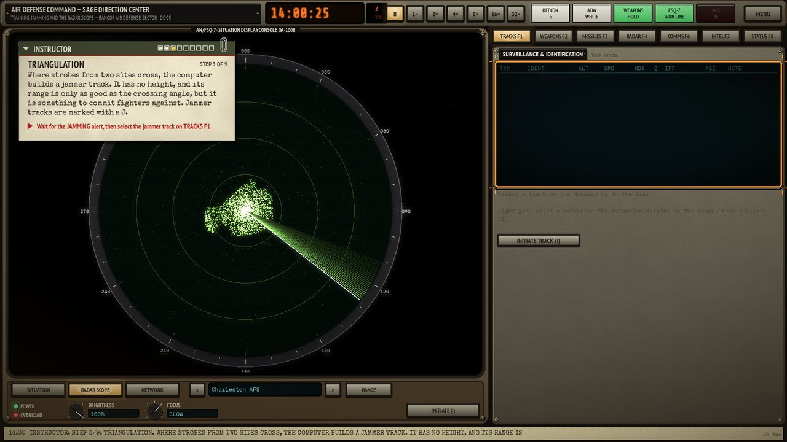
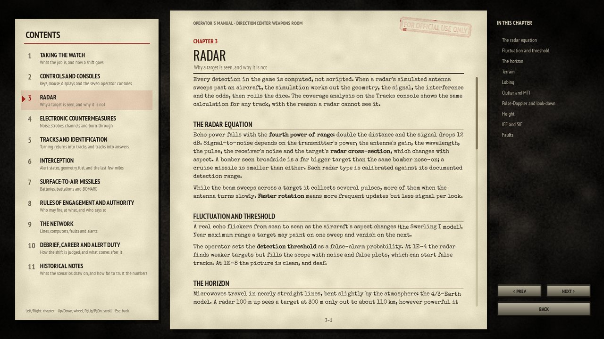
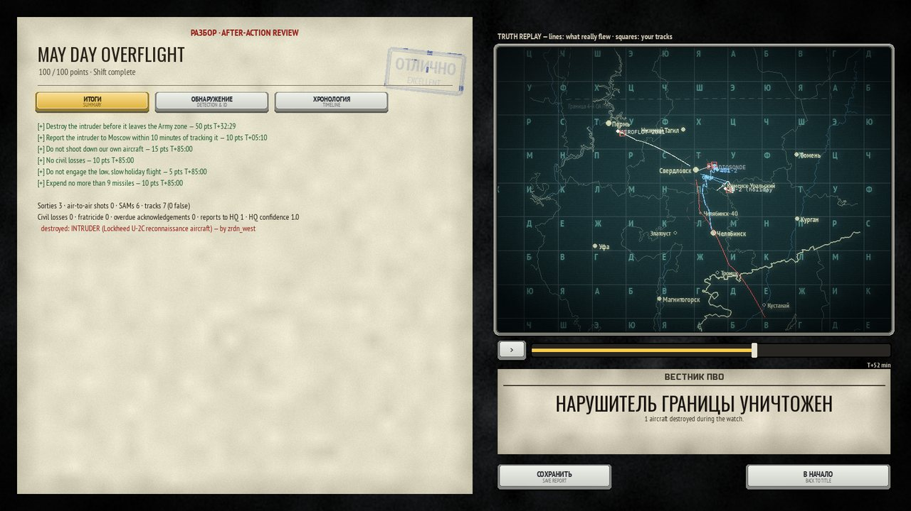

## Install and run

### Linux: the AppImage

One file with everything inside: its own Python, pygame-ce, numpy and the game. Download `SearchAndTrack-<version>-x86_64.AppImage` from [Releases](https://github.com/nrobertson152/Search-and-Track/releases), or the latest build from the artifacts of the newest [AppImage workflow run](https://github.com/nrobertson152/Search-and-Track/actions/workflows/appimage.yml), then:

```sh
chmod +x SearchAndTrack-*-x86_64.AppImage
./SearchAndTrack-*-x86_64.AppImage
```

It runs on x86_64 Linux distributions from about 2014 onward (glibc 2.17 or newer). On a system without FUSE, add `--appimage-extract-and-run`.

### From source

Developed and tested on Linux, with Python 3.10 or newer (tested on 3.10 and 3.13). Its only dependencies are pygame-ce and numpy (plus tomli on Python 3.10), so it should run on Windows and macOS too.

```sh
git clone https://github.com/nrobertson152/Search-and-Track.git
cd Search-and-Track
python -m pip install -e .
searchtrack                  # or: python -m searchtrack
```

Options: `--fullscreen`, `--no-sound`. The game is entirely offline and sends nothing anywhere. Saves, settings and your career live in `~/.local/share/searchtrack` (or `$XDG_DATA_HOME/searchtrack`; `%APPDATA%\searchtrack` on Windows).

**New to it?** Choose a service on the title screen, then **TRAINING**. The instructor's card is pinned to your display: it tells you what to do next, circles the controls to use, and marks what it means. The whole manual is in the game (OPERATOR'S MANUAL), and on GitHub in [docs/manual](docs/manual/README.md).

### Essential keys

| | |
|---|---|
| `Space` / `+` `-` | Pause / time compression up to 32× |
| `Enter` | ADVANCE: run at 96× until something needs you |
| Right click | Orders for a track or a flight (in battles: PRIORITY) |
| `M` | Situation display, radar scope, network board |
| `F1`–`F8` | Tracks, Weapons, Missiles, Radar, Comms, Intel (Battle), Status |
| `I` / `H` | Initiate a track at the light gun / height request |
| `F5` / `F9` | Quick save / quick load |
| `Esc` | Menu, manual, settings |

## Modding

Everything the simulation knows is plain text in `data/`:

- `aircraft.toml`, `radars.toml`, `sams.toml`, `weapons.toml`, `jammers.toml`, `factions.toml`: equipment, each entry tagged with its provenance.
- `scenarios/*.toml`: forces, flights and routes, triggers, objectives, intelligence, briefings, newspaper headlines. Training lessons are `[[lesson]]` steps, each with a `done` condition; see `data/scenarios/us_training_intercept.toml`. Battles add `[battle]`, `[[ship]]` and `[[group]]` tables and phases; a scenario can be written as changes to another (`base = "..."` with `group_patch`, `group_add`, `objective_drop`…), see `data/scenarios/us_battle_bering_2.toml`.
- `campaigns/*.toml`: the wars — which battles, in what order, with what replacements, reinforcing ships (`ship_join`) and repairs between them, which ships the force cannot fight without (`vital`, `skip_without`), and the story: `[cast]`, `[[intro]]`, `[[mission.page]]` (before, after or next; `when` an outcome, a choice, a ship or a radar lost), `[[lost]]` pages for the night a vital ship goes down and `[[epilogue]]` pages, with `{ace}`, `{fallen}`, `{kills}` and the like filled in from what happened.
- `ships.toml`: warships with their radars, missile channels and close-in guns.
- `theaters/*`: coastlines, borders, cities, sites and terrain, built by `tools/build_theater.py` from Natural Earth and ETOPO1.
- `manual/*.md`: the operator's manual; run `python tools/sync_manual.py` to refresh `docs/manual`.

## Development

```sh
python -m pip install -e ".[dev]"
python -m pytest                       # headless: SDL dummy drivers
python -m searchtrack --screenshot out.png --scenario us_northern_vigil --seconds 1800
tools/build_appimage.sh                # dist/SearchAndTrack-<version>-x86_64.AppImage
```

The simulation (`src/searchtrack/sim`) is deterministic, runs on a fixed 1-second tick, and knows nothing about the screen; the interface (`src/searchtrack/ui`) is an immediate-mode GUI on pygame-ce. A model student plays every training lesson in the tests, and the interface tests drive the real screens by clicking their buttons. See [AGENTS.md](AGENTS.md) for how the project is run, [docs/architecture](docs/architecture/technical-architecture.md) for the design, and [CHANGELOG.md](CHANGELOG.md) for what changed.

## Credits

- Coastlines, borders and cities: [Natural Earth](https://www.naturalearthdata.com/) (public domain). Terrain: ETOPO1 (NOAA, public domain).
- Fonts: IBM Plex Mono, Share Tech Mono, PT Mono, PT Sans Narrow, Oswald, Russo One, Courier Prime (SIL Open Font License 1.1); Special Elite (Apache License 2.0). Licence texts are in `assets/fonts/`.
- Historical background: see [docs/research](docs/research/cold-war-air-defense.md) for notes and sources. Scenarios are inspired by history, not reconstructions of it.
- All sound is synthesized at run time; all images are drawn by the program.

## Licence

GPL-3.0-or-later. See [LICENSE](LICENSE).
